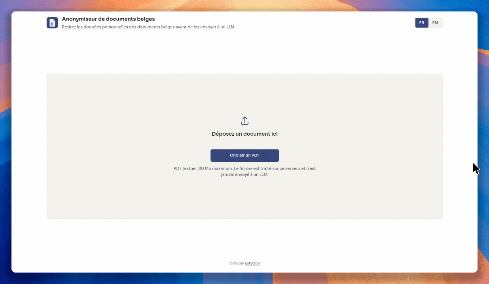
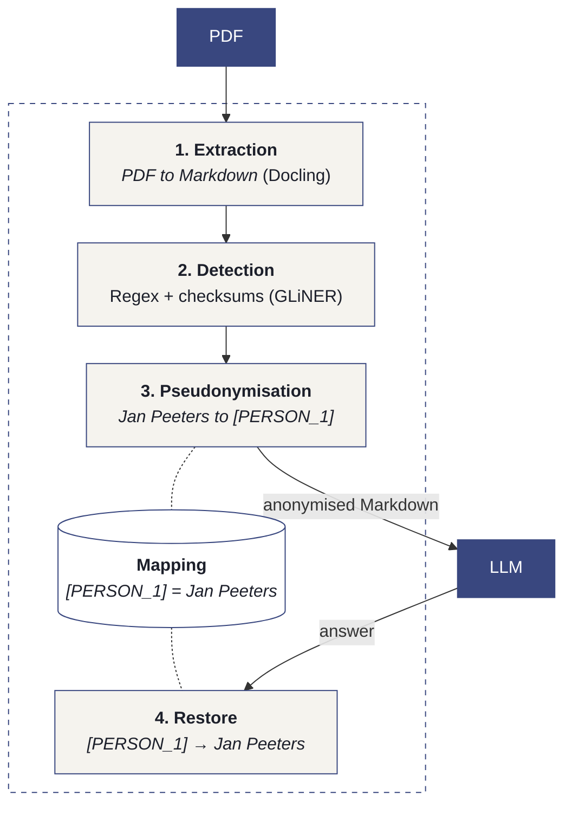

# Belgian documents anonymisation

A trial project to find out whether Belgian documents can be anonymised **locally**, before they
are sent to a large language model (LLM), so that its power can be used without exposing personal
data.



## How it works



Everything runs on your own machine, on CPU, without any network access once the Docker images
are built. Neither the document nor the detected values ever leave it. Only the anonymised Markdown
is meant to be sent to an LLM.

### 1. Extraction: PDF to Markdown

[Docling](https://github.com/docling-project/docling) (IBM) analyses the layout of each page with
its own models and converts the PDF to Markdown: headings, paragraphs, lists and **tables** are
kept, so the LLM receives a structured document rather than flat text. Images are replaced by an
`[IMAGE]` marker (their content is never analysed nor sent), and page headers and footers are left
out. 

A few corrections are applied on top of Docling: a hyphen at a line break is kept (so
identifiers such as `85.07.30-033.28` are not altered), paragraphs grouped together by mistake are
split again from the PDF line geometry ([pypdfium2](https://github.com/pypdfium2-team/pypdfium2)),
and a centred title is kept at the top of the page.

Only text-based PDFs are supported for now. Scanned documents are rejected (no OCR), and
multi-column layouts rely on Docling's reading order alone.

### 2. Detection: finding the personal data

Two complementary layers:

- **Belgian identifiers**, found with regular expressions and validated with their official
  checksums, so random digit sequences are not mistaken for personal data: national register and
  BIS numbers, enterprise/VAT numbers, IBANs (any country), eID card numbers, plus phone numbers,
  e-mail addresses, license plates and dates of birth (only after "né le", "geboren op"…, other
  dates are kept).
- **Names, organisations and addresses**, found by
  [GLiNER](https://github.com/urchade/GLiNER) (`gliner_multi_pii-v1`), a multilingual
  named-entity recognition model (French, Dutch, German, English) that runs on CPU.

The detections are then cleaned up: titles ("Monsieur", "Mevrouw") and contract roles ("le
Bailleur", "de Huurder") stay in clear text because they are useful to the LLM. A name found once
is searched for everywhere else in the document, so `Jan Peeters`, `JAN PEETERS`, `M. Peeters` and
`P. Peeters` are all recognised as the same person.

### 3. Pseudonymisation: reversible placeholders

Each value is replaced by a numbered placeholder, the same value always getting the same one:
`Jan Peeters` becomes `[PERSON_1]` everywhere, `BE68 5390 0754 7034` becomes `[IBAN_1]`. The LLM
can therefore still reason about who is who. The **mapping** (`[PERSON_1] to Jan Peeters`) stays in
the local API and can put the original values back in the LLM's answer
(`POST /documents/{id}/deanonymize`). Documents and mappings are kept in memory only, for one hour.

### The two parts

| Folder | Content |
|---|---|
| [`core/`](core/README.md) | Python engine and REST API ([FastAPI](https://fastapi.tiangolo.com)): extraction, detection, pseudonymisation, page previews. |
| [`demo/`](demo/README.md) | Demo interface ([Angular](https://angular.dev)): upload a PDF, compare the original (PDF or Markdown) with the anonymised document, export the anonymised Markdown. This is mainly intended to illustrate how this idea works, but is not essential per se. |

## Quick start

Only [Docker](https://docs.docker.com/get-docker/) is required:

```bash
docker compose up --build
```

- Demo: http://localhost:4200
- API documentation: http://localhost:8000/docs

The first build downloads the models (Docling layout and tables, GLiNER) and takes a few minutes;
the core image is about 3.7 GB (PyTorch for CPU and the models). After that, the stack runs fully
offline. On 8 CPU cores, a 3-page contract is processed in about 10 seconds.

Ten synthetic sample documents (contracts, letter, invoice, power of attorney…, in French, Dutch,
German and English) are in [`core/samples/`](core/samples/).
Development instructions (code layout, API, configuration, tests) are in the
[core](core/README.md) and [demo](demo/README.md) READMEs.

## Licensing

Every third-party component is under a permissive licence that allows commercial use. No copyleft (GPL/AGPL) dependency is used.

| Component | Licence |
|---|---|
| Docling (library) | MIT |
| Docling layout model (`docling-layout-heron`) | Apache-2.0 |
| Docling table model (TableFormer, `docling-models`) | CDLA-Permissive-2.0 |
| GLiNER (library) and `gliner_multi_pii-v1` model | Apache-2.0 |
| PyTorch (CPU), transformers | BSD-3-Clause, Apache-2.0 |
| pypdfium2 / PDFium | Apache-2.0 or BSD-3-Clause / BSD-3-Clause |
| FastAPI, Pydantic, Angular, marked, ngx-translate | MIT |
| Sora font | SIL Open Font License 1.1 |

The other Python and npm dependencies are under MIT, BSD, ISC, Apache-2.0 or MPL-2.0 (used
unmodified).

## Notes

Created by [Estytech](https://estytech.com). Do you have a technical project and need experts to
make it happen? [Contact us](https://estytech.com/en/contact).

Generative AI was used to generate certain parts of the code, which were then checked manually. However, some errors may remain.